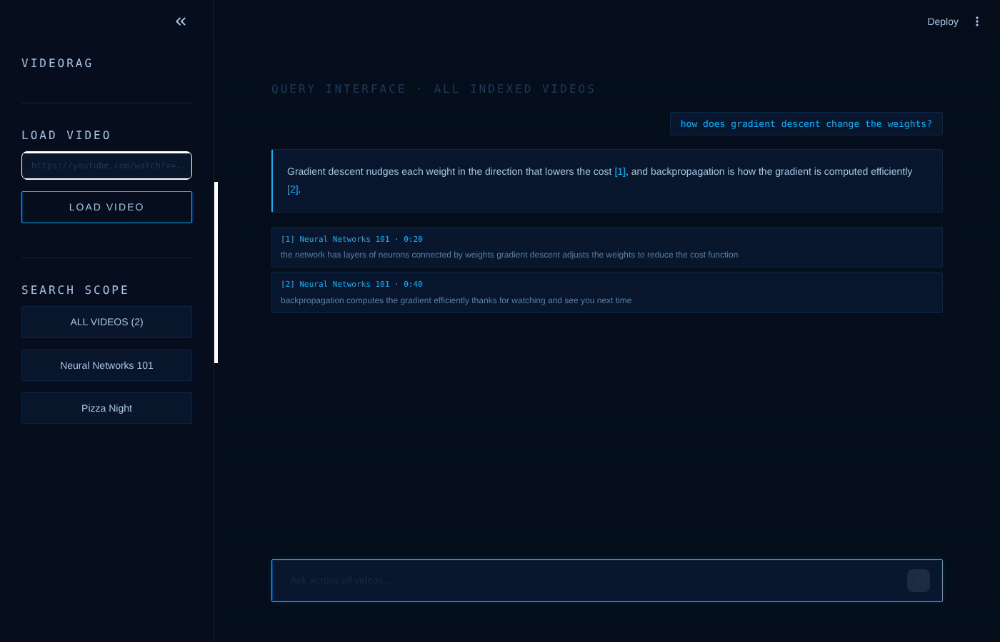
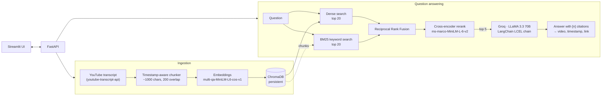
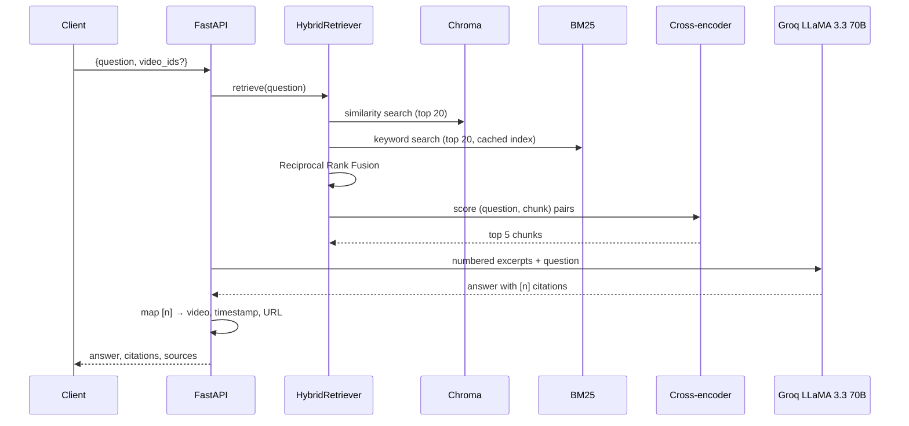

# VideoRAG

**Ask questions about YouTube videos and get answers cited to the exact moment they're said.**

VideoRAG indexes YouTube transcripts and answers questions with retrieval-augmented generation. Every claim in an answer carries a `[n]` citation that links to the video at the right timestamp. Retrieval is hybrid (BM25 keyword search + dense vector search, fused with Reciprocal Rank Fusion) and reranked by a cross-encoder before anything reaches the LLM.



<sub>The Streamlit UI answering across all indexed videos, with clickable citation cards (shown with the test fixtures).</sub>

---

## Features

- **Cited answers.** The LLM sees numbered transcript excerpts and must cite them (`[1]`, `[2][4]`). The API resolves each citation to the video, timestamp, deep link and quoted text, and drops citations to sources that don't exist.
- **Hybrid retrieval.** BM25 catches exact names, numbers and jargon that embeddings blur; dense search catches paraphrases. Rankings are merged with Reciprocal Rank Fusion, so no score calibration is needed.
- **Cross-encoder reranking.** The fused top 20 are re-scored by `cross-encoder/ms-marco-MiniLM-L-6-v2`, which reads the question and chunk together, and only the best 5 go to the LLM.
- **Timestamp-aware chunking.** Caption lines are grouped into ~1,000-character windows with ~200 characters of overlap, never splitting a line, so every chunk keeps an exact start time.
- **Multi-video search.** Ask across your whole library or restrict to specific videos.
- **Timestamped summaries.** Map-reduce summarisation that works on long videos and keeps a `[mm:ss]` marker on each point.
- **FastAPI service** with typed request/response models, OpenAPI docs at `/docs`, and clear error codes.
- **Streamlit UI** that talks to the API, with clickable citation cards.
- **Batch ingestion** of a list of videos, a **retrieval evaluation** script, **tests**, and **Docker Compose**.

---

## Architecture



### Request flow for `POST /ask`



---

## Quick start

### With Docker (recommended)

```bash
cp .env.example .env            # add your GROQ_API_KEY (free at console.groq.com)
docker compose up --build
```

- API and interactive docs: <http://localhost:8000/docs>
- UI: <http://localhost:8501>

Index a batch of videos into the running stack:

```bash
python -m scripts.ingest data/videos.txt --api http://localhost:8000
```

### Locally

```bash
python -m venv .venv && source .venv/bin/activate
pip install -r requirements.txt -r requirements-ui.txt
cp .env.example .env            # add GROQ_API_KEY

python -m scripts.ingest data/videos.txt     # index the video list into ./chroma_db
uvicorn videorag.api:app --reload            # API on :8000
streamlit run ui/app.py                      # UI on :8501
```

The first run downloads the embedding and reranker models (~100 MB total).

---

## API

| Method | Path | Description |
|---|---|---|
| `POST` | `/videos` | Index a video by URL or ID. `201` when indexed, `200` if it already was |
| `GET` | `/videos` | List indexed videos with chunk counts and duration |
| `DELETE` | `/videos/{video_id}` | Remove a video from the index |
| `POST` | `/ask` | Answer a question with citations (optionally limited to `video_ids`) |
| `POST` | `/videos/{video_id}/summary` | Timestamped summary of one video |
| `GET` | `/health` | Status, counts, and whether the LLM is configured |

**Example** (values illustrative)

```bash
curl -s localhost:8000/ask -H 'Content-Type: application/json' \
  -d '{"question": "What does backpropagation compute?", "top_k": 5}'
```

```json
{
  "question": "What does backpropagation compute?",
  "answer": "Backpropagation computes the gradient of the cost function with respect to every weight and bias [1][3]...",
  "citations": [
    {
      "index": 1,
      "video_id": "Ilg3gGewQ5U",
      "title": "Backpropagation explained",
      "start": 312.4,
      "end": 371.9,
      "timestamp": "5:12",
      "url": "https://www.youtube.com/watch?v=Ilg3gGewQ5U&t=312s",
      "text": "..."
    }
  ],
  "sources": ["... every chunk the model was shown ..."]
}
```

| Status | Meaning |
|---|---|
| `400` | Not a YouTube URL or video ID |
| `404` | Video not indexed |
| `422` | Invalid request, or YouTube has no transcript for the video |
| `502` | The LLM request failed |
| `503` | `GROQ_API_KEY` is not set (indexing still works) |

---

## Design decisions

**Why hybrid retrieval?** Transcripts are full of names, acronyms and numbers ("ReLU", "Adam", "GPT-2", "3e-4") that small embedding models represent poorly. BM25 matches them exactly, while dense search handles paraphrased questions. Running both and fusing the results covers each one's blind spots.

**Why Reciprocal Rank Fusion?** BM25 scores and cosine similarities are on different scales, so adding them requires tuning weights per corpus. RRF only uses ranks (`score = Σ 1/(60 + rank)`), so a chunk ranked well by both methods wins without any calibration.

**Why rerank with a cross-encoder?** Bi-encoder embeddings compare the question and chunk separately, which is fast but coarse. A cross-encoder reads them together and is far more accurate, but too slow to run over the whole index. Running it only over the top 20 fused candidates gets the accuracy at a small, fixed cost.

**Why numbered citations instead of trusting the model's links?** The model only outputs numbers. The server maps each number back to the real chunk metadata, so citations can't point to a video or timestamp that wasn't retrieved, and out-of-range numbers are discarded.

**Why chunk by caption lines?** Splitting on characters can cut a sentence and lose its timestamp. Grouping whole caption lines keeps an exact start time for every chunk, which is what makes the deep links accurate.

**Why not `langchain-community` for BM25 and reranking?** That package is being sunset, so keyword search uses `rank-bm25` and reranking uses a `sentence-transformers` cross-encoder directly. LangChain still provides the document model, the Chroma and Hugging Face integrations, the Groq chat model and the LCEL chains.

**Keyword index caching.** The BM25 index is built from the chunks in Chroma and cached per (store version, video filter). Any write bumps the store version, so the index rebuilds only when the corpus changes.

---

## Evaluating retrieval

`scripts/evaluate.py` compares dense-only, hybrid, and hybrid + rerank on your own labelled questions. Each line of the eval file marks where the answer is spoken:

```json
{"question": "What is the activation of a neuron?", "video_id": "aircAruvnKk", "start": 150, "end": 200}
```

```bash
python -m scripts.evaluate data/eval.jsonl --k 5               # search within each question's video
python -m scripts.evaluate data/eval.jsonl --k 5 --search-all  # search the whole library
```

A retrieved chunk counts as a hit when its time range overlaps the labelled window. The script prints Hit@1, Hit@k and MRR@k for each mode.

---

## Project structure

```
video-rag/
├── videorag/
│   ├── api.py           # FastAPI app: routes, schemas, error mapping
│   ├── pipeline.py      # VideoRAG: ingest, ask, summarize; builds the production pipeline
│   ├── retrieval.py     # BM25 + dense search, RRF fusion, cross-encoder reranking
│   ├── generation.py    # LCEL prompts and chains, citation parsing, map-reduce summaries
│   ├── store.py         # Chroma wrapper (LangChain), per-video operations
│   ├── chunking.py      # Timestamp-aware chunking into LangChain Documents
│   ├── transcripts.py   # URL parsing, transcript and title fetching
│   └── config.py        # Settings from environment / .env
├── ui/app.py            # Streamlit client of the API
├── scripts/
│   ├── ingest.py        # Index a list of videos (directly or through the API)
│   └── evaluate.py      # Hit@k / MRR comparison of retrieval modes
├── data/videos.txt      # Example video list
├── tests/               # pytest suite (no network or API key needed)
├── Dockerfile           # API image (CPU PyTorch, models baked in)
├── Dockerfile.ui        # UI image
└── docker-compose.yml
```

---

## Configuration

All settings can be overridden with environment variables (see `.env.example`).

| Variable | Default | Purpose |
|---|---|---|
| `GROQ_API_KEY` | (none) | Required for answers and summaries |
| `LLM_MODEL` | `llama-3.3-70b-versatile` | Groq model |
| `EMBEDDING_MODEL` | `sentence-transformers/multi-qa-MiniLM-L6-cos-v1` | Embedding model |
| `RERANKER_MODEL` | `cross-encoder/ms-marco-MiniLM-L-6-v2` | Cross-encoder |
| `USE_RERANKER` | `true` | Turn reranking off to compare |
| `TOP_K` | `5` | Chunks passed to the LLM |
| `CANDIDATES_PER_RETRIEVER` | `20` | Candidates from BM25 and from vector search |
| `CHUNK_TARGET_CHARS` / `CHUNK_OVERLAP_CHARS` | `1000` / `200` | Chunk size and overlap |
| `CHROMA_DIR` | `chroma_db` | Where the index is stored |

---

## Testing

```bash
pip install -r requirements-dev.txt
pytest
```

The suite covers URL parsing, chunking, RRF, BM25 filtering, citation parsing and every API endpoint. It runs against a real Chroma collection with fake embeddings, a fake cross-encoder and a fake LLM, so it needs no network, models or API key.

---

## Limitations

- Videos need captions (manual or auto-generated). YouTube sometimes blocks transcript requests from cloud IP ranges; indexing from your own machine avoids this.
- Answers are only as accurate as the transcript; auto-captions misspell names.
- The BM25 index lives in memory and is rebuilt after changes, which is fine for hundreds of videos but not millions.
